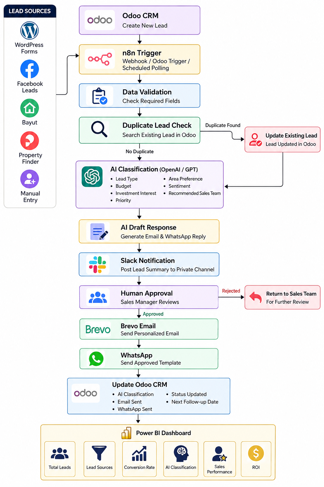

# AI Real Estate Lead Management

Webhook and manual intake, Odoo duplicate checks, AI classification and response drafting, Slack approval, email/WhatsApp outreach and follow-up.

**Status:** Sanitized workflow export for configuration and review. Inactive by default. Runtime behavior has not been verified in this publication process.

## Architecture

Entry points: `Lead Webhook (HTTP)`, `Manual Entry (Backend Form)`

Integrations: Odoo, OpenAI, Slack, Brevo, WhatsApp Business, Power BI HTTP endpoint.

## Setup

1. Import [workflow.json](workflow.json) into a compatible n8n installation. Verify that every node type and exported node version is supported.
2. Create the service credentials and replace all values listed in [CONFIGURATION.md](CONFIGURATION.md), including any existing source placeholders.
3. Configure destination resources, expected field names, template mappings and access scopes. Use isolated test accounts and synthetic data.
4. Resolve the review items below, then manually test success, rejection, missing-data and provider-failure paths. Inspect delivery/audit results before activation.

## Review before activation

- The manual form uses display labels while downstream expressions read the webhook body. Normalize the form payload before enabling this entry path.
- The Power BI HTTP destination is a placeholder; configure a supported destination and verify its schema.
- Confirm response and conversion checks query current CRM state before scheduling follow-ups.

## Validation

37 nodes and 36 connections inspected. JSON parsing, unique node names/IDs and connection targets checked. See [validation.json](validation.json). Static checks do not establish expression correctness, API compatibility, delivery success or production readiness. No service was contacted and no messages or calls were sent.

## Node inventory

| Node | Type | Exported operation |
| --- | --- | --- |
| Lead Webhook (HTTP) | `n8n-nodes-base.webhook` | default |
| Validate Required Fields | `n8n-nodes-base.if` | default |
| Duplicate Lead Check (Odoo) | `n8n-nodes-base.odoo` | default |
| Duplicate Found? | `n8n-nodes-base.if` | default |
| Update Existing Lead in Odoo | `n8n-nodes-base.odoo` | update |
| AI Classification (OpenAI / GPT) | `@n8n/n8n-nodes-langchain.openAi` | default |
| Create New Lead in Odoo | `n8n-nodes-base.odoo` | create |
| Invalid Lead - Missing Fields | `n8n-nodes-base.noOp` | default |
| Manual Entry (Backend Form) | `n8n-nodes-base.formTrigger` | default |
| Save AI Data to Odoo Lead | `n8n-nodes-base.odoo` | update |
| AI Draft Response (OpenAI / GPT) | `@n8n/n8n-nodes-langchain.openAi` | default |
| Format Email (HTML/Text) | `n8n-nodes-base.set` | default |
| Format WhatsApp Template | `n8n-nodes-base.set` | default |
| Attach Brochure / Project Details | `n8n-nodes-base.set` | default |
| Slack Lead Summary (Private Channel) | `n8n-nodes-base.slack` | default |
| Slack Message With Actions | `n8n-nodes-base.slack` | default |
| Human Approval (Sales Manager) | `n8n-nodes-base.slack` | sendAndWait |
| Approved? | `n8n-nodes-base.if` | default |
| Send Brevo Email (Approved Template) | `n8n-nodes-base.sendInBlue` | default |
| Send WhatsApp (Approved Template) | `n8n-nodes-base.whatsApp` | send |
| Update Odoo CRM Lead Status | `n8n-nodes-base.odoo` | update |
| Attach Follow-up Activity in Odoo | `n8n-nodes-base.odoo` | create |
| Notify Sales Team (Internal Note) | `n8n-nodes-base.slack` | default |
| Store Lead Data (Summary) | `n8n-nodes-base.set` | default |
| Send Data to Power BI | `n8n-nodes-base.httpRequest` | default |
| Wait / Delay (Until Follow-up Date) | `n8n-nodes-base.wait` | default |
| Follow-up Reminder (Internal Slack) | `n8n-nodes-base.slack` | default |
| AI Generate Follow-up Message | `@n8n/n8n-nodes-langchain.openAi` | default |
| Send Follow-up Email (If No Response) | `n8n-nodes-base.sendInBlue` | default |
| Send Follow-up WhatsApp (If No Response) | `n8n-nodes-base.whatsApp` | send |
| Lead Converted? | `n8n-nodes-base.if` | default |
| Mark as Won in Odoo CRM | `n8n-nodes-base.odoo` | update |
| End | `n8n-nodes-base.noOp` | default |
| Continue Nurture Sequence | `n8n-nodes-base.noOp` | default |
| Return to Sales Team for Review | `n8n-nodes-base.slack` | default |

## Source

Prepared from the owner-supplied export `Real Estate Lead Management (AI).json`. Existing in-workflow attribution and public reference links are retained where present; no sole-authorship claim is made for third-party templates or nodes. No independently verified production performance metrics are claimed. User-supplied visual references are identified below.

## Visual references

These owner-supplied visuals are documentation references. Historical canvases may differ from the current export. Diagrams and dashboard concepts are not runtime validation or evidence that all depicted features are implemented.

**Odoo CRM automation architecture — Design reference.** Broader target architecture; source adapters and Power BI reporting shown here are not all configured in the supplied exports.

Related visuals:

- [End-to-end lead management architecture](../../docs/images/lead-designs/end-to-end-lead-management.png) — Design reference. Diagram completion, production-readiness and benefit claims are source artwork labels, not validated publication results.

[Browse all 35 images](../../docs/GALLERY.md).
