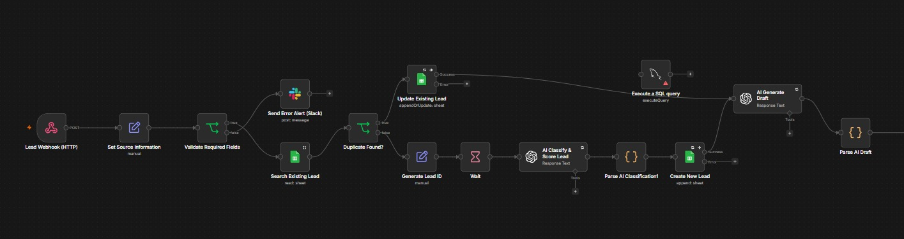

# Lead Management, Outreach and Reporting

Google Sheets lead intake, AI scoring and drafting, Slack approval, email/WhatsApp outreach, audit rows and an ElevenLabs/Twilio call branch.

**Status:** Sanitized workflow export for configuration and review. Inactive by default. Runtime behavior has not been verified in this publication process.

## Architecture

Entry points: `Lead Webhook (HTTP)`, `New Lead Found`

Integrations: Google Sheets, OpenAI, Slack, Brevo, WhatsApp Business, ElevenLabs / Twilio, MySQL.

## Setup

1. Import [workflow.json](workflow.json) into a compatible n8n installation. Verify that every node type and exported node version is supported.
2. Create the service credentials and replace all values listed in [CONFIGURATION.md](CONFIGURATION.md), including any existing source placeholders.
3. Configure destination resources, expected field names, template mappings and access scopes. Use isolated test accounts and synthetic data.
4. Resolve the review items below, then manually test success, rejection, missing-data and provider-failure paths. Inspect delivery/audit results before activation.

## Review before activation

- The source filename mentions Power BI, but this export contains no configured Power BI destination. Its MySQL node has no query. Reporting integration remains to be completed.
- Check Response Status is configured as appendOrUpdate, not a read. Review this before relying on response detection.
- The webhook and spreadsheet call branches use different payload shapes and field casing. Test both separately.
- Repeat Until Response / Stop is a noOp node, not an implemented stop policy. Define suppression, retry limits and stop conditions.

## Validation

48 nodes and 50 connections inspected. JSON parsing, unique node names/IDs and connection targets checked. See [validation.json](validation.json). Static checks do not establish expression correctness, API compatibility, delivery success or production readiness. No service was contacted and no messages or calls were sent.

## Node inventory

| Node | Type | Exported operation |
| --- | --- | --- |
| Lead Webhook (HTTP) | `n8n-nodes-base.webhook` | default |
| Validate Required Fields | `n8n-nodes-base.if` | default |
| Send Error Alert (Slack) | `n8n-nodes-base.slack` | default |
| Search Existing Lead | `n8n-nodes-base.googleSheets` | default |
| Duplicate Found? | `n8n-nodes-base.if` | default |
| Update Existing Lead | `n8n-nodes-base.googleSheets` | appendOrUpdate |
| Create New Lead | `n8n-nodes-base.googleSheets` | append |
| AI Classify & Score Lead | `@n8n/n8n-nodes-langchain.openAi` | default |
| AI Generate Draft | `@n8n/n8n-nodes-langchain.openAi` | default |
| Parse AI Draft | `n8n-nodes-base.code` | default |
| Post Lead Summary (Slack) | `n8n-nodes-base.slack` | default |
| Sales Manager Approval | `n8n-nodes-base.slack` | sendAndWait |
| Approved? | `n8n-nodes-base.if` | default |
| Return to Sales Team (Slack) | `n8n-nodes-base.slack` | default |
| Notify Sales Team (Rejected) | `n8n-nodes-base.slack` | default |
| Assign Lead | `n8n-nodes-base.set` | default |
| Send Email (Brevo) | `n8n-nodes-base.sendInBlue` | default |
| Merge Comms | `n8n-nodes-base.merge` | default |
| Send WhatsApp | `n8n-nodes-base.whatsApp` | default |
| Track Delivery Status | `n8n-nodes-base.set` | default |
| Update Google Sheets (Contacted) | `n8n-nodes-base.googleSheets` | update |
| Log & Audit Trail | `n8n-nodes-base.googleSheets` | append |
| Wait Until Follow-up Date | `n8n-nodes-base.wait` | default |
| Check Response Status | `n8n-nodes-base.googleSheets` | appendOrUpdate |
| Customer Replied? | `n8n-nodes-base.if` | default |
| Update Status (Interested/Meeting) | `n8n-nodes-base.googleSheets` | appendOrUpdate |
| Send Reminder Email | `n8n-nodes-base.sendInBlue` | default |
| Send Reminder WhatsApp | `n8n-nodes-base.whatsApp` | send |
| Create Call Task (in Sheet) | `n8n-nodes-base.googleSheets` | appendOrUpdate |
| Notify Sales Team (Follow-up) | `n8n-nodes-base.slack` | default |
| Repeat Until Response / Stop | `n8n-nodes-base.noOp` | default |
| Parse AI Classification1 | `n8n-nodes-base.code` | default |
| Generate Lead ID | `n8n-nodes-base.set` | default |
| Wait | `n8n-nodes-base.wait` | default |
| Set Source Information | `n8n-nodes-base.set` | default |
| New Lead Found | `n8n-nodes-base.googleSheetsTrigger` | default |
| Loop Over Leads | `n8n-nodes-base.splitInBatches` | default |
| Already Contacted? | `n8n-nodes-base.if` | default |
| Start AI Call (ElevenLabs + Twilio) | `n8n-nodes-base.httpRequest` | default |
| Wait For Call To End | `n8n-nodes-base.wait` | default |
| Get Call Summary & Outcome | `n8n-nodes-base.httpRequest` | default |
| Update Lead Row | `n8n-nodes-base.googleSheets` | update |
| Skip This Lead | `n8n-nodes-base.noOp` | default |
| Slack Notification (Customer Interested) | `n8n-nodes-base.slack` | default |
| IF Call Completed? | `n8n-nodes-base.if` | default |
| Wait 30 Seconds | `n8n-nodes-base.wait` | default |
| Customer Interested? | `n8n-nodes-base.if` | default |
| Execute a SQL query | `n8n-nodes-base.mySql` | executeQuery |

## Source

Prepared from the owner-supplied export `Final Lead Management Automation With Power BI.json`. Existing in-workflow attribution and public reference links are retained where present; no sole-authorship claim is made for third-party templates or nodes. No independently verified production performance metrics are claimed. User-supplied visual references are identified below.

## Visual references

These owner-supplied visuals are documentation references. Historical canvases may differ from the current export. Diagrams and dashboard concepts are not runtime validation or evidence that all depicted features are implemented.

**Lead intake and classification canvas — User-supplied workflow screenshot.** Partial historical workflow capture. Node layout and settings may differ from the current sanitized export; no runtime pass is inferred.

Related visuals:

- [AI CRM dashboard overview](../../docs/images/dashboard-concepts/ai-crm-overview.jpeg) — Dashboard concept. Illustrative dashboard; visible contact records and metrics have not been established as synthetic or verified production data.
- [Google Sheets to Power BI data flow](../../docs/images/lead-designs/sheets-to-power-bi-flow.png) — Design reference. Proposed push/synchronization flow, not proof of a live reporting connection.

[Browse all 35 images](../../docs/GALLERY.md).
