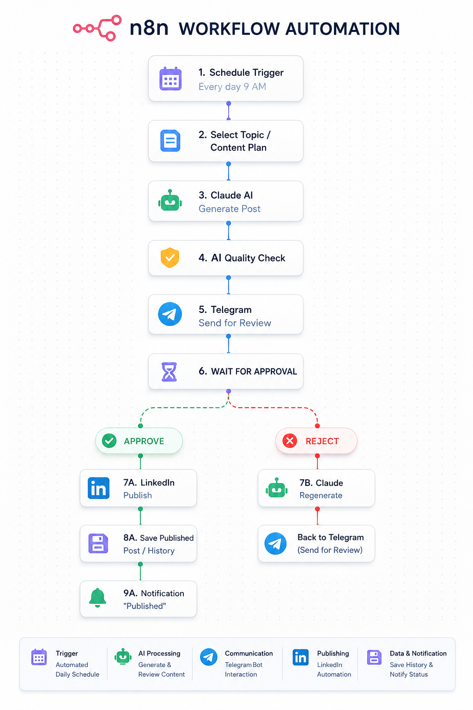

# Social Media Post Automation

Scheduled Google Sheets content selection, Anthropic post generation, Telegram review, Google Drive media retrieval, LinkedIn publishing and draft Facebook/Instagram media branches.

**Status:** Sanitized workflow export for configuration and review. Inactive by default. Runtime behavior has not been verified in this publication process.

## Architecture

Entry points: `Schedule Trigger`, `Schedule Trigger1`, `Telegram Trigger`

Integrations: Google Sheets, Anthropic, Telegram, Google Drive, LinkedIn, Facebook / Instagram Graph API.

## Setup

1. Import [workflow.json](workflow.json) into a compatible n8n installation. Verify that every node type and exported node version is supported.
2. Create the service credentials and replace all values listed in [CONFIGURATION.md](CONFIGURATION.md), including any existing source placeholders.
3. Configure destination resources, expected field names, template mappings and access scopes. Use isolated test accounts and synthetic data.
4. Resolve the review items below, then manually test success, rejection, missing-data and provider-failure paths. Inspect delivery/audit results before activation.

## Review before activation

- Several Facebook/Instagram Graph API nodes contain only empty options. These are unfinished publishing steps; configure destinations, operations and media payloads before use.
- Review both scheduled entry paths and the Telegram trigger to confirm approval, selected content and media remain correlated.
- Configure LinkedIn profile, Telegram chat, Drive resources, sheet columns and all required service credentials.
- Validate image/video binary mappings, publishing status polling and post-success sheet updates using test destinations.
- Confirm rejection and duplicate-run behavior before enabling scheduled publication.

## Validation

36 nodes and 33 connections inspected. JSON parsing, unique node names/IDs and connection targets checked. See [validation.json](validation.json). Static checks do not establish expression correctness, API compatibility, delivery success or production readiness. No service was contacted and no messages or calls were sent.

## Node inventory

| Node | Type | Exported operation |
| --- | --- | --- |
| Schedule Trigger | `n8n-nodes-base.scheduleTrigger` | default |
| Get row(s) in sheet | `n8n-nodes-base.googleSheets` | default |
| Filter | `n8n-nodes-base.filter` | default |
| Limit | `n8n-nodes-base.limit` | default |
| Create a post | `n8n-nodes-base.linkedIn` | default |
| Update row in sheet | `n8n-nodes-base.googleSheets` | update |
| Prepare Post Data | `n8n-nodes-base.set` | default |
| Image or Video | `n8n-nodes-base.switch` | default |
| Download Image | `n8n-nodes-base.googleDrive` | download |
| Facebook Graph API | `n8n-nodes-base.facebookGraphApi` | default |
| Instagram - Create Media | `n8n-nodes-base.facebookGraphApi` | default |
| Instagram - Publish Media | `n8n-nodes-base.facebookGraphApi` | default |
| Download Video | `n8n-nodes-base.googleDrive` | download |
| Instagram - Create Reel | `n8n-nodes-base.facebookGraphApi` | default |
| Wait | `n8n-nodes-base.wait` | default |
| Instagram - Check Reel | `n8n-nodes-base.facebookGraphApi` | default |
| If1 | `n8n-nodes-base.if` | default |
| Instagram - Publish Reel | `n8n-nodes-base.facebookGraphApi` | default |
| Facebook - Start Reel | `n8n-nodes-base.facebookGraphApi` | default |
| Facebook - Upload Reel | `n8n-nodes-base.facebookGraphApi` | default |
| Facebook - Publish Reel | `n8n-nodes-base.facebookGraphApi` | default |
| If | `n8n-nodes-base.if` | default |
| Message a model | `@n8n/n8n-nodes-langchain.anthropic` | default |
| Send message and wait for response | `n8n-nodes-base.telegram` | sendAndWait |
| Prepare LinkedIn Post | `n8n-nodes-base.code` | default |
| Send a photo message | `n8n-nodes-base.telegram` | sendPhoto |
| Search files and folders | `n8n-nodes-base.googleDrive` | default |
| Download file | `n8n-nodes-base.googleDrive` | download |
| Download Approved Image | `n8n-nodes-base.googleDrive` | download |
| Schedule Trigger1 | `n8n-nodes-base.scheduleTrigger` | default |
| Get row(s) in sheet1 | `n8n-nodes-base.googleSheets` | default |
| Filter1 | `n8n-nodes-base.filter` | default |
| Limit1 | `n8n-nodes-base.limit` | default |
| Create a post1 | `n8n-nodes-base.linkedIn` | default |
| Update row in sheet1 | `n8n-nodes-base.googleSheets` | update |
| Telegram Trigger | `n8n-nodes-base.telegramTrigger` | default |

## Source

Prepared from the owner-supplied export `Social Media Post Automation.json`. Existing in-workflow attribution and public reference links are retained where present; no sole-authorship claim is made for third-party templates or nodes. No independently verified production performance metrics are claimed. User-supplied visual references are identified below.

## Visual references

These owner-supplied visuals are documentation references. Historical canvases may differ from the current export. Diagrams and dashboard concepts are not runtime validation or evidence that all depicted features are implemented.

**Approval-based social publishing — Design reference.** Conceptual generate-review-publish flow; verify rejection and regeneration behavior in the actual workflow.

Related visuals:

- [Social publishing text flow](../../docs/images/social-designs/social-publishing-text-flow.png) — Design reference. Text diagram of proposed approval and rejection paths.
- [Multi-platform social publishing architecture](../../docs/images/social-designs/multi-platform-social-design.png) — Design reference. Proposed multi-site and multi-platform scope, not evidence that every platform is implemented or tested.

[Browse all 35 images](../../docs/GALLERY.md).
